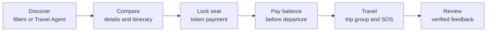
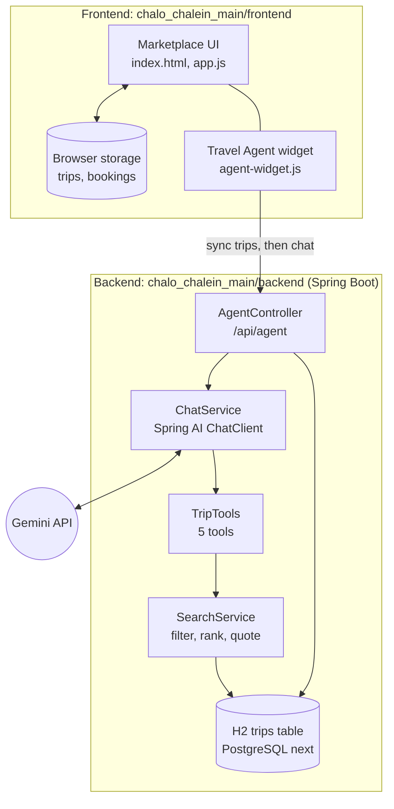
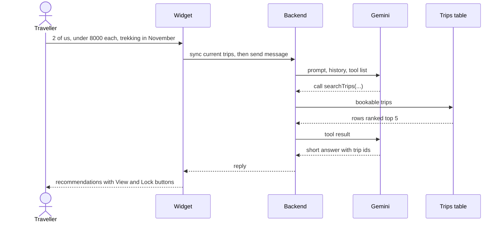

# Chalo Chalein

**One platform to find, compare and book group travel packages in India, with an AI Travel Agent that picks the right trip for you.**

Chalo Chalein is a marketplace for youth group trips. Travellers lock a seat with a small token, and organisers manage seats and rosters in one place instead of Instagram DMs.

> **Status:** the marketplace UI and AI Travel Agent work end to end. The full database-backed product (accounts, bookings, payments, escrow) is **in progress**. See [Future scope](#future-scope).

## The problem

Group trips in India are sold mostly through Instagram pages and DMs, so travellers compare prices by hand and pay strangers by UPI.

- **Scale:** about [553 million Instagram users in India](https://stats.napoleoncat.com/instagram-users-in-india/2026/06/) (June 2026), roughly 77% aged 18 to 34 ([NapoleonCat](https://stats.napoleoncat.com/instagram-users-in-india/2026/05/)).
- **Market:** India's packaged holidays market is about [USD 11 billion and fragmented](https://www.dsgcp.com/insights/why-we-partnered-with-wanderon-building-indias-most-loved-experiential-travel-platform), and domestic tourist visits reached about [2.95 billion in 2024](https://www.policyedge.in/p/india-tourism-data-compendium-2025).
- **Trust risk:** for example, a couple lost [₹1.56 lakh to a fake Instagram Bali package](https://www.freepressjournal.in/mumbai/juinagar-couple-duped-of-156-lakh-by-fake-instagram-travel-agents-for-bali-trip).
- **Organisers** track seats and deposits in chats and spreadsheets.

There is no public count of Instagram travel-group pages, so these figures show the audience and market they operate in.

## The solution

- **Travellers:** one place to browse trips with filters, lock a seat with a token, and pay the balance later. Escrow protection is part of the design.
- **Organisers:** host a batch, track live seats, and download rosters.
- **AI Travel Agent:** describe budget, group size, month and vibe, and it recommends matching trips with a "View & Lock" button.



## Architecture



## How the AI agent works

Gemini knows nothing about our trips. It picks a Java **tool**, our code queries the trips at that moment, and Gemini writes the answer from the results. It never guesses prices, dates or seats.



**Tools:** `searchTrips`, `listDestinations`, `getTripDetails`, `compareTrips`, `checkAvailabilityAndCost`.

## How the backend works

- **Trip sync (temporary):** trips currently live in the browser, so the widget sends them to `PUT /api/agent/trips/sync` before each message. The agent therefore answers from exactly what the traveller sees.
- **Search:** only future trips with enough seats from verified organisers are considered. If nothing fits, it relaxes price (+30%) and trip length (±2 days) and says so.
- **Ranking:** activity, vibe and month matches, price closeness to budget, and organiser rating.
- **Guardrails:** the agent is read-only, only states facts from tool results, caps messages at 1,000 characters, and fails fast if Gemini is overloaded.

| Endpoint | Purpose |
| :--- | :--- |
| `PUT /api/agent/trips/sync` | Replace the agent's trips with the site's current trips |
| `POST /api/agent/chat` | Body `{message, conversationId}`, returns `{reply}` |
| `GET /api/agent/health` | Backend status and trip count |

## Tech stack

Java 21, Spring Boot 4, Spring AI 2 with Google Gemini, Spring Data JPA, H2 (PostgreSQL driver included), Maven, and a vanilla HTML, CSS and JavaScript frontend.

## Run it on your machine

**Prerequisites:** JDK 21+, Git, a free [Gemini API key](https://aistudio.google.com/apikey), and Python 3 (or any static file server). Maven is not needed.

```bash
git clone https://github.com/PranavKaushik653/Chalo_Chalein.git
cd Chalo_Chalein/chalo_chalein_main
```

**1. Backend (port 8081).** Set the key as an environment variable and never commit it.

```bash
export GEMINI_API_KEY="your_key"      # PowerShell: $env:GEMINI_API_KEY="your_key"
cd backend
./mvnw spring-boot:run                # Windows: .\mvnw.cmd spring-boot:run
```

**2. Frontend (port 5500).** In a second terminal:

```bash
cd chalo_chalein_main/frontend
python -m http.server 5500
```

**3.** Open http://localhost:5500 and click the animated **Travel Agent** button. Try `2 of us, under ₹8,000 each, trekking in November`.

Optional: set `GEMINI_MODEL` to choose the Gemini model. Check http://localhost:8081/api/agent/health to confirm the backend is up.

| Problem | Fix |
| :--- | :--- |
| Widget can't reach the service | Backend isn't running, or the port differs |
| Gemini `403` or `404` | Create a new key, or change `GEMINI_MODEL` |
| Gemini `503` or slow answers | The model is overloaded; switch to another model |

## Future scope

**In progress: moving from a browser-stored demo to a complete, database-backed product.**

1. PostgreSQL for trips, organisers, bookings and reviews, behind Spring Boot APIs. The frontend and agent read the same database, and the sync bridge is removed.
2. JWT auth, organiser KYC and GST verification, and the SOS backend.
3. Redis seat locks (10-minute TTL), optimistic locking and idempotent booking APIs.
4. Payment gateway escrow, delayed payouts, automatic refunds and waitlist.
5. Agent upgrades: streaming, persistent memory, RAG for vibe and review search, evals, and a fallback model.

## Author

**Pranav Kaushik**, backend engineer, building Chalo Chalein.