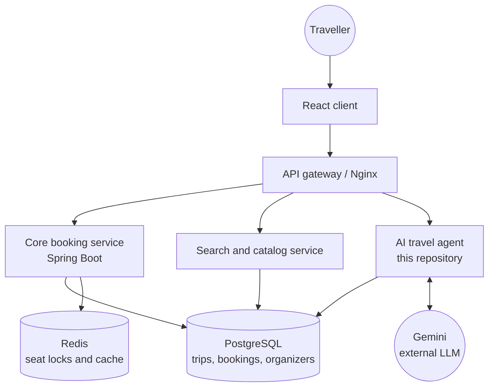
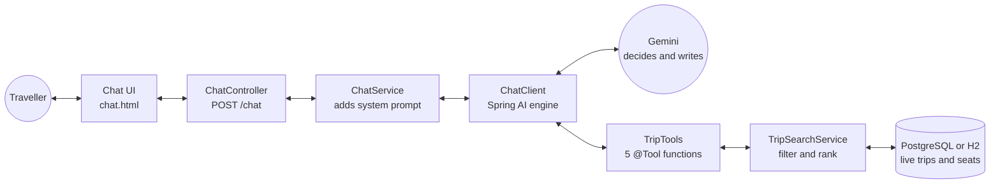
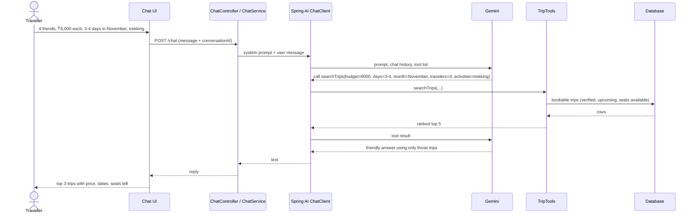
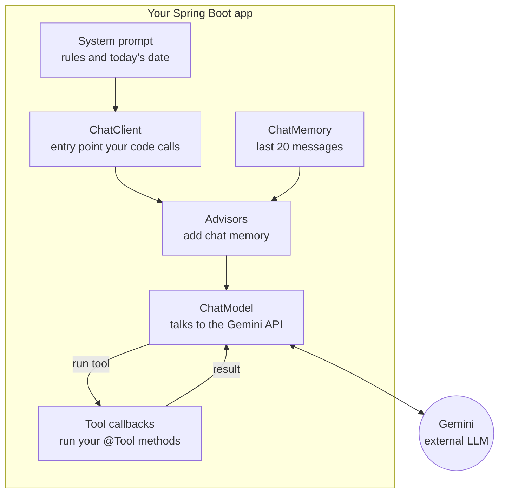

# Chalo Chalein Travel Agent

An AI trip-finder for **Chalo Chalein** (this is an idea which I am currently working and building upon), a platform where young travellers in India discover and join group trips with other travellers. Instead of reading dozens of trip listings one by one, a traveller tells the agent their budget, group size, number of days, month and the kind of experience they want. The agent searches the trips that are currently bookable and recommends the best matches.

> This repository is one module of the larger Chalo Chalein platform (see [Where this fits](#where-this-fits-in-chalo-chalein)). It runs on its own with demo data, and it is designed to point at the platform's real trips database.

---

## Table of contents

- [The problem](#the-problem)
- [What the agent can do](#what-the-agent-can-do)
- [Where this fits in Chalo Chalein](#where-this-fits-in-chalo-chalein)
- [How it works](#how-it-works)
- [Tech stack](#tech-stack)
- [Prerequisites](#prerequisites)
- [Run it on your machine](#run-it-on-your-machine)
- [Try these prompts](#try-these-prompts)
- [Configuration](#configuration)
- [Project structure](#project-structure)
- [Design decisions](#design-decisions)
- [Roadmap](#roadmap)
- [Author](#author)

---

## The problem

Youth group travel in India is scattered. Hundreds of boutique tour operators run their own websites and Instagram pages, each with its own trips, prices and dates. A traveller who wants "a 3 to 4 day trek in November under ₹6,000 per person for 4 friends" has to open many pages, compare them manually and still can't be sure seats are available.

**Chalo Chalein** brings those trips into one marketplace. This **Travel Agent** is the conversational layer on top: it turns a plain-English request into a search over live trip data and gives a short, honest recommendation.

## What the agent can do

- Understand free-text requests: destination or region, budget per person, number of days, group size, activities, travel month and departure city.
- Recommend up to 3 trips with price, dates, seats left and a one-line reason for each.
- Compare trips side by side ("KSL-01 vs TRN-01").
- Calculate group cost, the token amount to lock seats, and the balance due date.
- Check seat availability for the whole group.
- Suggest destinations when the request is vague ("surprise me").
- Say clearly when nothing matches exactly and explain what was relaxed (for example, "budget stretched by 30%").
- Remember the conversation, so follow-ups like "which one is cheaper?" work.

Rules the agent follows:

- It only talks about trips that came back from the database. It never invents prices, dates or seats.
- It only sees trips from **verified** organizers that are upcoming and have enough seats.
- It cannot book anything. Booking and payment stay in the platform's own booking flow.

## Where this fits in Chalo Chalein

Chalo Chalein is a two-sided marketplace: travellers on one side, trip organizers on the other. The platform handles discovery, seat reservation with a token payment, escrow, organizer verification and reviews. The Travel Agent is the discovery assistant, and it reads from the same trips data.



The agent never writes to the trips tables. It only reads them, so a wrong answer can never change booking data.

## How it works

The agent uses **tool calling**. Gemini does not know anything about our trips. When a traveller asks a question, Gemini decides which Java tool to call, our code queries the database at that moment, and Gemini writes the answer from the fresh results. Prices and seat counts are therefore always as current as the database.

### The full flow



### Example request, step by step



### Spring AI pieces



| Term | What it is |
| :--- | :--- |
| `ChatClient` | The object our code calls to build and send a request to the model. |
| System prompt | Standing instructions for the assistant: rules, tone and today's date. |
| Advisors | Interceptors around every call. Ours adds conversation memory. |
| `ChatMemory` | Stores recent messages per conversation id (last 20). |
| `ChatModel` | The Gemini connector from the Spring AI Google GenAI starter. |
| Tool callbacks | Spring AI's wrapper that runs our `@Tool` methods when Gemini asks for them. |

### The tools

| Tool | Purpose |
| :--- | :--- |
| `searchTrips` | Search by destination, budget per person, min/max days, travellers, activities, month and departure city. Ranks and returns up to 5 trips. |
| `listDestinations` | Lists destinations that currently have bookable trips, with price range and trip length. |
| `getTripDetails` | Full details of one trip by its code (for example `KSL-01`). |
| `compareTrips` | Compares 2 to 4 trips side by side. |
| `checkAvailabilityAndCost` | Seats left, group total, token to lock seats now, balance and balance due date. |

When nothing matches every filter, `searchTrips` automatically relaxes them (budget up to +30%, trip length ±2 days, month and activities used only for ranking) and tells the model exactly what it relaxed.

## Tech stack

| Layer | Technology |
| :--- | :--- |
| Language | Java 21 |
| Framework | Spring Boot 4.0.8 |
| AI framework | Spring AI 2.0.1 (`spring-ai-starter-model-google-genai`) |
| LLM | Google Gemini (via Google AI Studio API key) |
| Web | Spring MVC, Thymeleaf, plain HTML/CSS/JavaScript chat page |
| Persistence | Spring Data JPA, Hibernate |
| Database | H2 in-memory (default demo) or PostgreSQL (`postgres` profile) |
| Utilities | Lombok |
| Build | Maven (wrapper included) |

## Prerequisites

| Requirement | Notes |
| :--- | :--- |
| JDK 21 | Check with `java -version`. Any distribution works (Temurin, Corretto, Oracle). |
| Git | To clone the repository. |
| Gemini API key | Free to create at [Google AI Studio](https://aistudio.google.com/apikey). |
| Internet access | The app calls the Gemini API. The first Maven build also downloads dependencies. |
| Maven | Not needed. The project includes the Maven wrapper (`mvnw`). |
| PostgreSQL 14+ | Optional. Only needed if you use the `postgres` profile. |

## Run it on your machine

### 1. Clone

```bash
git clone https://github.com/PranavKaushik653/Travel_Agent.git
cd Travel_Agent
```

### 2. Set your Gemini API key

Never put the key in source code or commit it. Use an environment variable.

macOS / Linux:

```bash
export GEMINI_API_KEY="your_key_here"
```

Windows PowerShell:

```powershell
$env:GEMINI_API_KEY="your_key_here"
```

Windows Command Prompt:

```cmd
set GEMINI_API_KEY=your_key_here
```

Optional: choose the Gemini model (check Google's docs for the current model names).

```bash
export GEMINI_MODEL="gemini-2.5-flash"
```

### 3. Start the app

macOS / Linux:

```bash
./mvnw spring-boot:run
```

Windows:

```cmd
mvnw.cmd spring-boot:run
```

The first run downloads dependencies, so give it a minute. On startup the app creates an in-memory database and seeds demo trips (you'll see a "Seeded ... demo trips" log line).

### 4. Open the chat

Go to **http://localhost:8080** and start chatting. Watch the terminal: each tool the agent calls is logged, for example:

```
[TOOL] searchTrips dest=null budget=6000 days=3-4 people=4 activities=[trekking] month=November from=null
[TOOL] searchTrips -> 3 trip(s), exactMatch=true
```

### Using PostgreSQL instead of the demo database

1. Create a database, for example `chalochalein`.
2. Set the connection details and start with the `postgres` profile:

```bash
export DB_URL="jdbc:postgresql://localhost:5432/chalochalein"
export DB_USER="postgres"
export DB_PASSWORD="your_password"
./mvnw spring-boot:run -Dspring-boot.run.profiles=postgres
```

The `postgres` profile turns demo seeding off and uses `ddl-auto=update` to create the `organizers` and `trips` tables. Insert your own trips, or use the platform's real data.

## Try these prompts

- `4 friends, ₹6,000 each, 3-4 days in November, we want trekking`
- `Cheap beach trip from Bengaluru, 3 days, 2 people`
- `Compare KSL-01 and TRN-01 for me`
- `Can all 4 of us go on KSL-01? How much to lock seats?`
- `Surprise me, where can I go this winter?`
- `We are 5 people with ₹30,000 total, anything in the mountains?`

The demo data includes deliberate edge cases so you can test behaviour: a sold-out trip (`CRG-01`), a trip with 1 seat left (`KSL-02`), and a trip from an unverified organizer (`SHT-01`) that must never be recommended.

## Configuration

| Property / env var | Default | Meaning |
| :--- | :--- | :--- |
| `GEMINI_API_KEY` | none (required) | Your Gemini API key. |
| `GEMINI_MODEL` | `gemini-2.5-flash` | Gemini model name. |
| `chalo.seed-demo-data` | `true` | Seeds demo trips only when the trips table is empty. |
| `spring.profiles.active` | none | Use `postgres` to switch to PostgreSQL. |
| `DB_URL`, `DB_USER`, `DB_PASSWORD` | local Postgres defaults | PostgreSQL connection (postgres profile). |

## Project structure

```
src/main/java/com/travel/ai_agent/
├── AiAgentApplication.java        # Spring Boot entry point
├── config/AiConfig.java           # ChatClient, tools and chat memory wiring
├── controller/
│   ├── ChatController.java        # POST /chat endpoint
│   └── ChatViewController.java    # Serves the chat page
├── service/
│   ├── ChatService.java           # System prompt and the call to the model
│   └── TripSearchService.java     # Filtering, ranking, cost and availability logic
├── tools/
│   ├── TripTools.java             # The @Tool functions Gemini can call
│   └── FlightTool, HotelTools, WeatherTools   # Placeholders for future tools
├── entity/                        # Organizer and Trip JPA entities
├── repository/                    # Spring Data repositories
├── dto/TripDtos.java              # Compact result shapes returned to the model
└── seed/DemoDataSeeder.java       # Demo data (only when the table is empty)

src/main/resources/
├── templates/chat.html            # Chat UI
├── static/                        # CSS and JS assets
├── application.properties         # Default config (H2 + Gemini)
└── application-postgres.properties
```

## Design decisions

- **Tool calling, not RAG, for structured data.** Budget, days, seats and dates are exact fields, so SQL-style filtering is more accurate than vector search. RAG will be added later for fuzzy requests and reviews.
- **The database is the source of truth.** The model keeps no copy of trips, so answers always reflect live data.
- **The model only sees safe data.** Only upcoming trips with seats from verified organizers are exposed.
- **Short trip codes** (`KSL-01`) instead of UUIDs, so the model can reference trips reliably.
- **Honest fallbacks.** If nothing matches, the agent says so and explains how it relaxed the search.
- **Read-only agent.** It cannot book or change data. Booking goes through the platform's Redis-locked, idempotent booking flow.

## Roadmap

- Streaming responses for a faster-feeling chat
- Persistent chat memory (JDBC or Redis) so it works across multiple server instances
- Move filtering into SQL with indexes, or Elasticsearch, as the catalog grows
- RAG with `pgvector` for "vibe" search ("offbeat, not touristy") and review-based answers
- Reviews and organizer ratings as a tool
- Personalized ranking using past bookings and ChaloCash history
- Rate limiting, request timeouts and a fallback search when the LLM is unavailable
- An evaluation suite of test questions to catch regressions when prompts or models change
